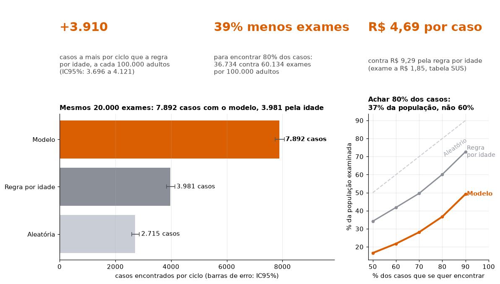

# Triagem de diabetes com CRISP-DM

Atividade de Ciência de Dados: as seis fases do CRISP-DM aplicadas a um problema de saúde, com ETL, EDA, análise preditiva e data storytelling para chegar a uma decisão.

[](https://colab.research.google.com/github/CodePenguinsCorp/diabetes-crisp-dm/blob/main/Diabetes_CRISP-DM.ipynb)

**Instituição:** Católica de Santa Catarina

**Disciplina:** Ciência de Dados

**Professor:** Claudinei Dias (Ney)

**Autor:** José Henrique Brühmüller

## Trabalho principal

Abra **[Diabetes_CRISP-DM.ipynb](Diabetes_CRISP-DM.ipynb)**. O notebook contém a documentação, o código em Python e as saídas da execução (gráficos e tabelas), organizados nas seis fases do CRISP-DM.

**Problema:** um programa de saúde só consegue examinar uma parte da população por ciclo. Com capacidade para **20% das pessoas**, quem chamar primeiro para o exame de diabetes para encontrar o maior número de casos?

| Fase CRISP-DM | Seção do notebook | Técnica |
|---|---|---|
| 1. Entendimento do negócio | 1 | Problema, decisão e critérios de sucesso definidos antes da modelagem |
| 2. Entendimento dos dados | 2 | EDA |
| 3. Preparação dos dados | 3 | ETL |
| 4. Modelagem | 4 | Análise preditiva |
| 5. Avaliação | 5 | Teste, intervalos de confiança, subgrupos |
| 6. Implantação | 6 | Impacto, data storytelling e decisão |

## Dados e metodologia

- Fonte: [CDC Diabetes Health Indicators, UCI](https://archive.ics.uci.edu/dataset/891/cdc+diabetes+health+indicators), pesquisa BRFSS 2015 dos Estados Unidos. Detalhes, licença e hash em [data/README.md](data/README.md).
- 253.680 respostas e 21 variáveis de questionário (pressão alta, IMC, saúde geral, idade, renda e outras), sem exames de laboratório. O alvo é diabetes ou pré-diabetes (13,9% da base).
- **ETL:** remoção do ID, limite do IMC em 60, variável `n_condicoes` (condições de saúde relatadas) e divisão estratificada em 70% treino, 15% validação e 15% teste. As 24.206 linhas repetidas foram mantidas, com justificativa no notebook.
- **Modelagem:** base ingênua, regra simples por idade, regressão logística, random forest e HistGradientBoosting (oito configurações). Seleção pela AUC-PR na validação; modelo escolhido reajustado em treino e validação e avaliado uma vez no teste.
- **Métrica de decisão:** captura de casos entre os 20% de maior risco e lift, porque o uso é ordenar uma fila. A acurácia não serve com 14% de positivos.

## Resultados no teste

Teste com 38.052 pessoas. Modelo escolhido: HistGradientBoosting (taxa de aprendizado 0,05, 31 folhas).

| Estratégia | Casos encontrados com 20% dos exames | Casos a cada 1.000 examinados |
|---|---:|---:|
| Seleção aleatória | 19,5% | 139 |
| Regra simples por idade | 28,6% | 199 |
| **Modelo** | **56,6%** | **395** |

- AUC-PR de 0,421 (IC95% 0,408 a 0,435) contra 0,139 da seleção aleatória. Lift@20% de 2,83 (IC95% 2,78 a 2,90).
- Para encontrar **80% dos casos**, o modelo precisa examinar 36,7% da população; a regra por idade precisa de 60,1%, cerca de 39% mais exames.
- Variáveis que mais pesam: IMC, saúde geral autoavaliada, número de condições de saúde e idade.



## Impacto e decisão para a gestão

**Ideia central.** Ordenar a convocação pela nota de risco, em vez da idade, encontra cerca de **3.900 casos a mais por ciclo** a cada 100 mil adultos com os mesmos 20 mil exames, ou os mesmos casos com **39% menos exames**. A gestão deve adotar a fila por risco e criar uma ação própria para os adultos de 18 a 44 anos.

A cada 100 mil adultos, com exame a **R$ 1,85** (valor do procedimento "dosagem de glicose" na tabela SUS, código 02.02.01.047-3):

| Estratégia | Casos encontrados com 20 mil exames | Custo de exame por caso encontrado |
|---|---:|---:|
| Seleção aleatória | 2.715 | R$ 13,63 |
| Regra simples por idade (cenário inercial) | 3.981 | R$ 9,29 |
| **Modelo (intervenção)** | **7.892** (IC95% 7.739 a 8.067) | **R$ 4,69** |

Para encontrar 80% dos casos, a regra por idade exige 60.134 exames e o modelo 36.734: **23.400 exames a menos por ciclo**, cerca de R$ 43 mil só em exames. O valor em reais é pequeno porque o exame no SUS é barato: o ganho principal é achar o dobro de casos com a mesma capacidade. No setor privado (cerca de R$ 6 a R$ 23 por exame, segundo tabelas de sites de conteúdo, fonte fraca) a economia chega a R$ 140 mil até R$ 538 mil por ciclo. O notebook traz a sensibilidade ao custo e à capacidade.

Plano de ação: (1) adotar a fila por risco; (2) dimensionar a capacidade pela meta, cerca de 37% da população para achar 80% dos casos; (3) criar uma ação para adultos de 18 a 44 anos; (4) acompanhar casos por 1.000 exames, custo por caso e cobertura por subgrupo a cada ciclo; (5) retreinar com dados locais.

**Limite da conta:** só o pagamento do exame entra (sem coleta, logística e convocação). O benefício clínico de achar o caso mais cedo (complicações evitadas) não foi estimado, e é ele que fecha o retorno completo.

**O que não deu certo:** dos três critérios de sucesso fixados antes da modelagem, dois foram atendidos (lift acima de 2,0 e ganho sobre a regra por idade). O terceiro, cobertura mínima de 50% em todos os subgrupos, não foi: adultos jovens (27%) e renda alta (42%) ficam sub-representados. Está discutido no notebook.

**Limitações:** dados dos Estados Unidos (2015) e autodeclarados, alvo que reúne diabetes e pré-diabetes, estudo de corte transversal. O modelo ordena risco; não diagnostica nem prova causa.

## Executar no Google Colab

1. Clique no botão **Abrir no Colab** acima.
2. Execute todas as células em ordem (**Ambiente de execução > Executar tudo**). Sem o CSV local, o notebook baixa os dados da UCI automaticamente.
3. A execução leva poucos minutos. A pasta `resultados/` criada na sessão pode ser baixada.

## Executar localmente

Com Python 3.10 ou superior, em um terminal na pasta do projeto:

```powershell
python -m venv .venv
.\.venv\Scripts\python.exe -m pip install -r requirements.txt
.\.venv\Scripts\python.exe -m ipykernel install --user --name diabetes-crisp-dm --display-name "Diabetes CRISP-DM"
```

Abra o notebook no VS Code ou no Jupyter, selecione o kernel **Diabetes CRISP-DM** e execute todas as células. O ambiente da execução de referência está em `resultados/metadados.json`; o `requirements.txt` define faixas compatíveis, sem garantir resultados idênticos entre versões.

## Arquivos

| Arquivo/pasta | Conteúdo |
|---|---|
| `Diabetes_CRISP-DM.ipynb` | Trabalho completo e executável, com resultados salvos |
| `data/raw/` | CSV original da UCI, sem alteração |
| `data/README.md` | Fonte, licença e integridade dos dados |
| `resultados/CONCLUSAO.md` | Resumo e decisão recomendada |
| `resultados/*.png` | Seis figuras: EDA, avaliação e painel de impacto |
| `resultados/*.csv` | Métricas, decis, subgrupos, importância e capacidade necessária e impacto por 100 mil adultos |
| `resultados/modelo.joblib` | Modelo final, variáveis e corte usado na função `priorizar()` |
| `resultados/metadados.json` | Versões, semente, partições e métricas |
| `roteiro_apresentacao.md` | Roteiro de 8 minutos para a apresentação |
